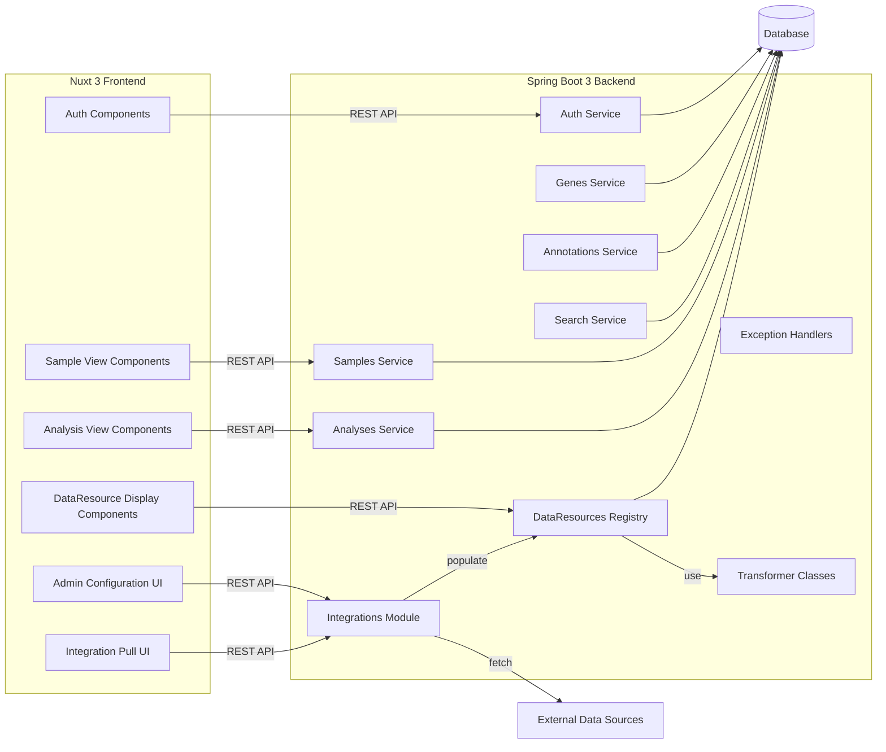

Install Nuxi
============
`npx nuxi@latest init`

Creating an Admin User
======================
On the command line
gradlew admin --args="create-user admin 123456 science@uw.edu Science Guy"

Design
======
## Overview

This repository implements a multi‑omics web application built on a Spring Boot 3 backend and a Nuxt 3 frontend. It is designed for loose coupling between services and rapid rollout of new visualizations and data integrations.

### Backend

* **Modular Services**

    * **Auth**, **Genes**, **Annotations**, **Samples**, **Analyses**, **Search**, **Exceptions**
    * **Transformers**: encapsulate data‑format conversions and business logic
    * **Integrations**: connectors for external data sources
    * **DataResources Registry**: each entry binds

        1. a pointer to one data file
        2. the transformer class that prepares the data
        3. the name of the frontend component used to render it

* **Design Goals**

    * **Loose Coupling**: each service and transformer operates independently, communicating via well‑defined APIs and registry entries
    * **Extensibility**: new assays or integrations require only

        1. implementing a transformer
        2. registering its DataResource (file pointers + component name)

### Frontend

* **Dynamic Visualization**

    * Nuxt 3 components automatically discover and render every DataResource associated with a Sample or Analysis
    * Admin UI for managing DataResources and integration settings

* **Quick Development**

    * To add a new visualization:

        1. Create a Vue component
        2. Register it in the DataResources registry
        3. The system will fetch, transform, and display the new data without further wiring

This architecture ensures that backend and frontend remain decoupled, and that introducing new genomics assays or external data feeds is as simple as dropping in a new transformer and component.

