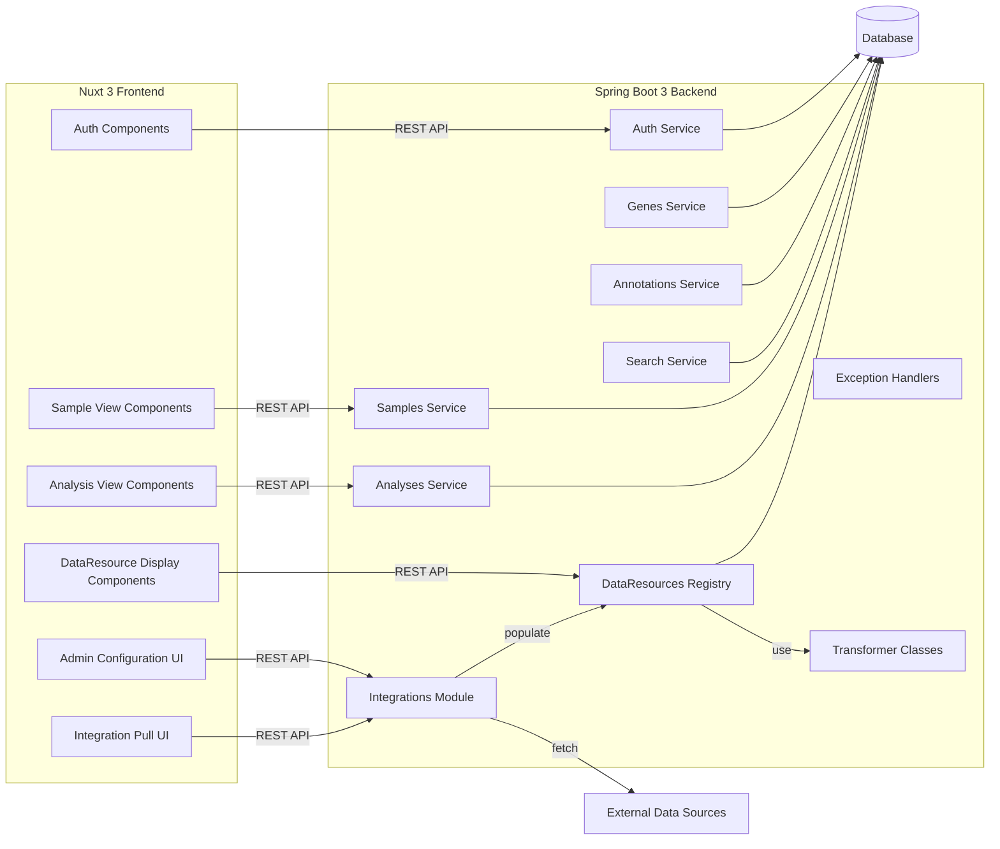

Install Nuxi
============
`npx nuxi@latest init`

Creating an Admin User
======================
On the command line
gradlew admin --args="create-user admin 123456 science@uw.edu Science Guy"

# IntelliJ IDEA Setup

This guide walks through setting up the project in IntelliJ IDEA. The project consists of three modules: `frontend`, `backend`, and `shared`.

## Prerequisites

Before starting, ensure you have installed:
- IntelliJ IDEA (Ultimate recommended for full framework support)
- JDK 21 or later (for backend/Spring Boot)
- Node.js 20+ and npm/yarn (for frontend/Nuxt)
- PostgreSQL 16+ (for database)
- Gradle (will be handled by IntelliJ)

## 1. Clone and Import the Project
### Option 1 From Version Control
1. Open IntelliJ and select  **File > New > Project from Version Control**
2. Select "GitHub" from the version control dropdown
3. Paste your repository URL
    - Alternatively, login to GitHub through IntelliJ to browse your repositories
4. Set the parent directory where the project should be cloned
5. Click **Clone**

### Option 2 From Existing Sources
1. Clone the repository from GitHub:
   ```bash
   git clone [YOUR_GITHUB_REPO_URL]
2.  Open IntelliJ and select  **File > New > Project from Existing Sources**
3.  Navigate to the cloned repository and select the root directory
4.  Select "Import project from external model" and choose "Gradle" (this will handle the backend module)
5.  Complete the Gradle import wizard with default settings


## 2. Set Up Modules

### Shared Module

1.  Right-click on the  `shared`  folder in the project view
2.  Select  **New > Module from Existing Sources**
3.  Select **Create module from existing sources**
4.  Follow the wizard, ensuring IntelliJ detects it as a Node.js/TypeScript project
5.  Click "Finish" to complete setup


### Frontend Module

1.  Right-click on the  `frontend`  folder
2.  Select  **New > Module from Existing Sources**
3.  Select **Create module from existing sources**
4.  Follow the wizard, ensuring IntelliJ detects it as a Node.js/Nuxt project
5.  Click "Finish" to complete setup


### Backend Module
The Gradle import should have already set up the backend module \
Verify the module exists in **File > Project Structure > Modules**

#### If the module doesn't exist create it:
1. Select **New > Module from Existing Sources**
2. Select **Import module from external module**
3. Select **Gradle**
4. Follow the wizard, ensuring Intellij detects it as a Java project
5. Click "Finish to complete setup"


## 3. Configure Run/Debug Configurations

IntelliJ should automatically generate these run configurations. If not, create them manually:

### Server: Nuxt (Frontend)

1.  Go to Run > Edit Configurations
2.  Click  `+`  and select "npm"
3.  Name:  `server: nuxt`
4.  Package: select the  `frontend/package.json`
5.  Command:  `run`
6.  Scripts:  `dev`
7.  Working directory:  `frontend`


### UwMultiomicsBrowserApplication (Backend)

1.  Go to Run > Edit Configurations
2.  Click  `+`  and select "Spring Boot"
3.  Name:  `UwMultiomicsBrowserApplication`
4.  Main class:  `com.uw.UwMultiomicsBrowserApplication`
5.  Environment variables:  `SPRING_PROFILES_ACTIVE=dev`
6.  Working directory:  `backend`


### For Automatically Generated Configurations:

-   Edit  `UwMultiomicsBrowserApplication`  and ensure "Active profiles" is set to  `dev`


## 4. Database Setup

1.  Ensure PostgreSQL is running
2.  Execute the setup script:
    ``` bash
    psql -U postgres -f backend/sql/001_Create_Database_and_User.sql
    ```
    Or manually:
    ```SQL
    CREATE DATABASE multiomics;
    CREATE USER multiomic WITH PASSWORD '1234567';
    GRANT ALL PRIVILEGES ON DATABASE multiomics TO multiomic;
    ```

## 5. Additional Configuration

### Environment Variables

The backend may require these environment variables in the future:
-   `DATABASE_URL`:  `jdbc:postgresql://localhost:5432/multiomics`
-   `DATABASE_USERNAME`:  `multiomic`
-   `DATABASE_PASSWORD`:  `1234567`

The frontend requires these environment variables in the frontend/.env file:
-   `NODE_TLS_REJECT_UNAUTHORIZED=0`
-   `API_URL="http://localhost:8081/**"`
-   `IGV_PROXY_URL="https://burnet.gs.washington.edu/samplify/ServeIgvDataFile/"`

The frontend requires these environment variables in the frontend/.env.local file:
-   `API_URL="http://localhost:3005/multiomics"`
-   `IGV_PROXY_URL="https://burnet.gs.washington.edu/samplify/ServeIgvDataFile/"`


### Frontend Setup

1.  Open terminal in the  `frontend`  directory
2.  Install dependencies:
    ```bash
    npm install
    ```    

### Backend Setup

1.  IntelliJ should have already resolved Gradle dependencies
2.  If needed, refresh Gradle projects (via Gradle tool window)


## First Run

1.  Start the database (if not already running)
2.  Run  `UwMultiomicsBrowserApplication`  (backend)
3.  Run  `server: nuxt`  (frontend)
4.  Access:
    -   Frontend:  [http://localhost:3000](http://localhost:3000/)
    -   Backend API:  [http://localhost:3005](http://localhost:3005/)


## Troubleshooting

-   If modules aren't recognized, try File > Invalidate Caches / Restart
-   For Gradle issues, try refreshing Gradle projects (Gradle tool window > refresh icon)
-   Ensure Node.js and JDK are properly configured in File > Project Structure > SDKs

Design
======
## Overview

This repository implements a multi‑omics web application built on a Spring Boot 3 backend and a Nuxt 3 frontend. It is designed for loose coupling between services and rapid rollout of new visualizations and data integrations.

### Backend

* **Modular Services**

    * **Auth**, **Genes**, **Annotations**, **Samples**, **Analyses**, **Search**, **Exceptions**
    * **Transformers**: encapsulate data‑format conversions and business logic
    * **Integrations**: connectors for external data sources
    * **DataResources Registry**: each entry binds

        1. a pointer to one data file
        2. the transformer class that prepares the data
        3. the name of the frontend component used to render it

* **Design Goals**

    * **Loose Coupling**: each service and transformer operates independently, communicating via well‑defined APIs and registry entries
    * **Extensibility**: new assays or integrations require only

        1. implementing a transformer
        2. registering its DataResource (file pointers + component name)

### Frontend

* **Dynamic Visualization**

    * Nuxt 3 components automatically discover and render every DataResource associated with a Sample or Analysis
    * Admin UI for managing DataResources and integration settings

* **Quick Development**

    * To add a new visualization:

        1. Create a Vue component
        2. Register it in the DataResources registry
        3. The system will fetch, transform, and display the new data without further wiring

This architecture ensures that backend and frontend remain decoupled, and that introducing new genomics assays or external data feeds is as simple as dropping in a new transformer and component.


